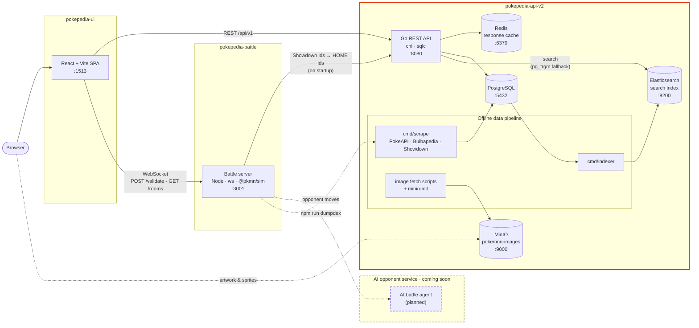
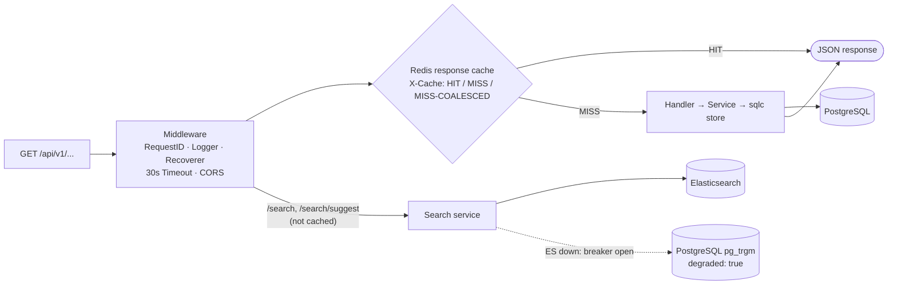
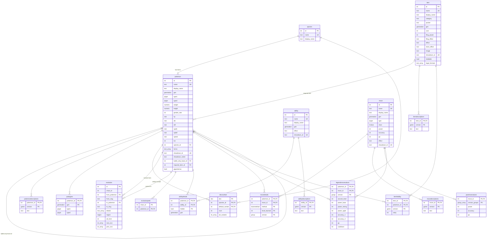

# PokePedia (API)
The REST API that powers the [PokePedia Web Version](https://github.com/Rishi2804/pokepedia-ui) and the
[PokePedia Battle Service](https://github.com/Rishi2804/pokepedia-battle-service). It serves every Pokémon, form, move,
ability and item from *Red and Blue* through *Scarlet/Violet* and *Legends: Z-A*, along with fast typo-tolerant site search
and the image store for all artwork and battle sprites.

This is v2 of the API, rewritten in Go from the original [Spring Boot API](https://github.com/Rishi2804/PokePedia-api).

## Technologies 💻
- Go 1.26 with [chi](https://github.com/go-chi/chi) (HTTP router)
- PostgreSQL 17 + [pgx](https://github.com/jackc/pgx) (Database)
- [sqlc](https://sqlc.dev) (type-safe Go generated from SQL queries)
- [golang-migrate](https://github.com/golang-migrate/migrate) (schema and data migrations)
- Redis 7 (response cache)
- Elasticsearch 9 (site search)
- MinIO (S3-compatible image store)
- Docker Compose (local stack), plus optional pgAdmin, RedisInsight and Kibana

## System Design 🏗️
PokePedia is split into three services. This repo is the API and its data stores (highlighted).



### Request flow
Every reference-data endpoint is a plain `GET` over data that only changes when the pipeline runs, so whole responses are cached in Redis.
Both Redis and Elasticsearch are optional: if either is down, a circuit breaker opens and requests carry on without it.



- **Cache:** keys are `pp:v3:resp:<path>`. Only complete `200` JSON responses up to 1 MB are stored, written in the background. Identical concurrent misses share one database call (singleflight). The breaker opens after 5 Redis errors for 30s.
- **Search:** results are ranked by exact slug, exact name, prefix, n-gram, fuzzy match and then description text, with a popularity boost. If Elasticsearch fails 3 times, search falls back to Postgres trigram matching for 20s and marks the response `"degraded": true`.

## API Endpoints 📡
All endpoints are `GET`. `{id}` routes take a numeric id, and `{name}` routes take a slug such as `charizard` or `thunderbolt`.

| Endpoint | Description |
|---|---|
| `/healthz` | Database, cache and search status (`503` only if the database is down) |
| `/api/v1/search?q=&size=` | Site search across Pokémon, moves, abilities and items, grouped by type |
| `/api/v1/search/suggest?q=&limit=` | Typeahead suggestions (names only) |
| `/api/v1/pokemon/{id \| name}` | A Pokémon: stats, types, abilities, dex numbers, descriptions, evolution chain and learnsets |
| `/api/v1/species/{id \| name}` | A species with all of its forms |
| `/api/v1/pokedex/{name}` | A game's Pokédex, grouped by regional dex (e.g. `national`, `scarlet-violet`) |
| `/api/v1/team-building/{version}` | Team builder candidates for a version group |
| `/api/v1/team-building/{version}/{id}` | One candidate with the moves and abilities it can use in that game |
| `/api/v1/team-building/items/{format}` | Holdable items legal in a battle format (`1`–`9`, `nationaldex`, `legendsza`) |
| `/api/v1/move/` · `/api/v1/move/{id \| name}` | All moves · one move with effects, history, descriptions and learners |
| `/api/v1/ability/` · `/api/v1/ability/{id \| name}` | All abilities · one ability with descriptions and Pokémon |
| `/api/v1/item/` · `/api/v1/item/{id \| name}` | All items · one item with details, descriptions and wild held-by data |

## Database Diagram 🗄️
The schema after the latest migration (`000024`). `PK` = primary key, `FK` = foreign key, `UK` = unique.



**Custom types:**

| Type | Values |
|---|---|
| `ptype` | The 18 types plus `stellar` |
| `mclass` | `physical`, `special`, `status` |
| `learnmethod` | `level-up`, `egg`, `tutor`, `machine`, `light-ball-egg`, `form-change`, `zygarde-cube` |
| `group` | The 22 version groups, `red-blue` … `legends-za` |
| `game` | The 38 individual games, `red` … `legends-za` |
| `dex` | The 33 Pokédexes, `national` … `hyperspace` |
| `region` | `alola`, `galar`, `hisui`, `paldea` (regional evolutions) |
| `generation` | Domain over `int`, 1–12 |
| `stat` | Domain over `int`, 1–255 |

`*_array` columns are Postgres arrays (`text[]`, `int[]`, `group[]`). The `pg_trgm` extension powers the search fallback.

## Data Pipeline 🔄
The API is read-only, and all data is loaded ahead of time:

1. **Database:** on first start, Postgres loads the baseline dump in `db/init.sql` (migration 12). `make migrate-up` then applies `db/migrations/000013`+ up to the latest version.
2. **Scraping (`cmd/scrape`):** fills gaps from [PokeAPI](https://pokeapi.co), [Bulbapedia](https://bulbapedia.bulbagarden.net) and Pokémon Showdown data (`cmd/scrape/data/showdown-*.json`, made by `npm run dumpdex` in the battle service). It can write straight to the database or `-emit` a migration file. Separate passes are picked with `-only` (`pokemon,move,ability` descriptions, `item`, `names`, `eggmoves`, `legends`), and responses are cached in `cmd/scrape/.cache/`.
3. **Images:** `make sprites` downloads Showdown battle sprites and `make item-images` downloads item icons into `object_store/seed/`. The `minio-init` container uploads everything in `seed/` to the public `pokemon-images` bucket.
4. **Search index (`cmd/indexer`):** builds search documents for every Pokémon, move, ability and item. They are bulk-loaded into a new versioned index, then the `pokepedia-search` alias is switched over in one step and old indexes are cleaned up (`-keep`, default 2).

### Image store layout
```
pokemon-images/
├── home/          # Pokémon HOME renders (+ shiny/, female/)
├── official/      # Official artwork (+ shiny/)
├── items/         # Item icons, <slug>.png
└── showdown/
    └── sprites/   # Showdown battle sprites: ani, ani-back, ani-shiny, gen1–gen5, ...
```
`object_store/seed/` is gitignored. Use the fetch scripts for sprites and item icons; the HOME and official artwork need to be placed in `seed/home` and `seed/official` yourself.

## Getting Started 🚀
### Prerequisites
- Docker + Docker Compose
- Go 1.26+ (to run the API, scraper or indexer outside Docker)
- [golang-migrate CLI](https://github.com/golang-migrate/migrate/tree/master/cmd/migrate) (`brew install golang-migrate`)
- [sqlc](https://docs.sqlc.dev/en/latest/overview/install.html) (only if you change queries)
- `jq` (for `make item-images`)

### Environment
Create a `.env` file in the project root:

| Variable | Description |
|---|---|
| `PORT` | API port (default `8080`) |
| `APP_ENV` | Environment name |
| `DATABASE_URL` | Postgres URL from the host, e.g. `postgres://<user>:<password>@localhost:5432/pokepediadb?sslmode=disable` (required) |
| `REDIS_URL` | Redis URL, e.g. `redis://localhost:6379/0`. Leave empty to turn caching off |
| `ELASTIC_URL` | Elasticsearch URL, e.g. `http://localhost:9200`. Leave empty to use Postgres-only search |
| `DOCKER_DATABASE_URL`, `DOCKER_REDIS_URL`, `DOCKER_ELASTIC_URL` | The same three URLs as seen from inside the Compose network (e.g. host `postgres` instead of `localhost`) |
| `POSTGRES_USER`, `POSTGRES_PASSWORD` | Postgres credentials |
| `MINIO_ROOT_USER`, `MINIO_ROOT_PASSWORD` | MinIO credentials |

Optional tuning: `CACHE_TTL` (default `24h`), `CACHE_OP_TIMEOUT` (`150ms`), `ELASTIC_INDEX` (`pokepedia-search`), `ELASTIC_OP_TIMEOUT` (`800ms`).

### Run it
```bash
docker compose up -d    # postgres, minio (+ minio-init), redis, elasticsearch and the API on :8080
make migrate-up         # init.sql only goes up to migration 12, so apply the rest
make index              # build the Elasticsearch index
make cache-flush        # clear cached responses after changing data
```

To run the API on the host instead of in Docker, start the data stores and run `make run`.

Optional admin UIs:
```bash
docker compose --profile tools up -d pgadmin4 redisinsight kibana
# pgAdmin :5050 · RedisInsight :5540 · Kibana :5601
```

### Make targets
| Target | Description |
|---|---|
| `run` / `build` | Run the API, or build it to `bin/api` |
| `docker-up` / `docker-down` | Start or stop the Compose stack |
| `migrate-up` / `migrate-down` / `migrate-version` / `migrate-force` | Manage migrations |
| `sqlc-generate` | Regenerate `internal/store` from `db/queries` |
| `scrape` / `scrape-dry` / `scrape-emit` | Run the scraper, preview it, or emit it as a migration |
| `index` / `index-dry` | Build the search index, or preview it |
| `es-health` / `es-aliases` | Check Elasticsearch cluster health and aliases |
| `cache-flush` | Clear the Redis response cache |
| `sprites` / `item-images` | Download battle sprites / item icons into `object_store/seed/` |

### Running the whole stack
Clone [pokepedia-ui](https://github.com/Rishi2804/pokepedia-ui) and [pokepedia-battle-service](https://github.com/Rishi2804/pokepedia-battle-service) next to this repo, then start the API first, followed by the battle server and the UI (`docker compose up -d` in each).

## Testing 🧪
```bash
go test ./...
```
Unit tests cover the scraper's parsers (wikitext, items, egg moves, Legends data, names), the item and Pokédex services, and slug helpers.

## Project Structure 📁
```
cmd/
├── api/          # API server entrypoint
├── scrape/       # Data scraper (PokeAPI, Bulbapedia, Showdown)
└── indexer/      # Elasticsearch index builder
internal/
├── server/       # Router and route registration
├── handlers/     # HTTP handlers
├── service/      # Business logic and response mapping
├── dto/          # Response shapes
├── store/        # sqlc-generated queries and models
├── cache/        # Redis client
├── search/       # Elasticsearch client, query builder and index mapping
├── breaker/      # Circuit breaker for Redis and Elasticsearch
├── middleware/   # CORS, logging and the response cache
├── pokeenum/     # Pokédex and version group tables
├── config/       # Environment config
└── util/         # Slug and name helpers
db/
├── init.sql      # Baseline dump (migration 12)
├── migrations/   # golang-migrate migrations
└── queries/      # SQL for sqlc
object_store/     # MinIO init and image fetch scripts
```
